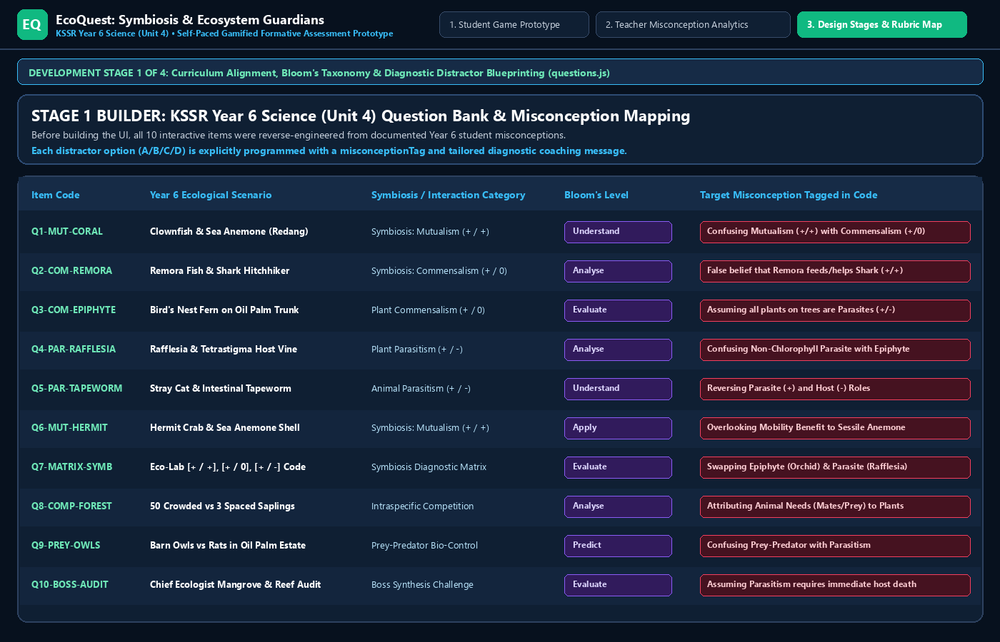
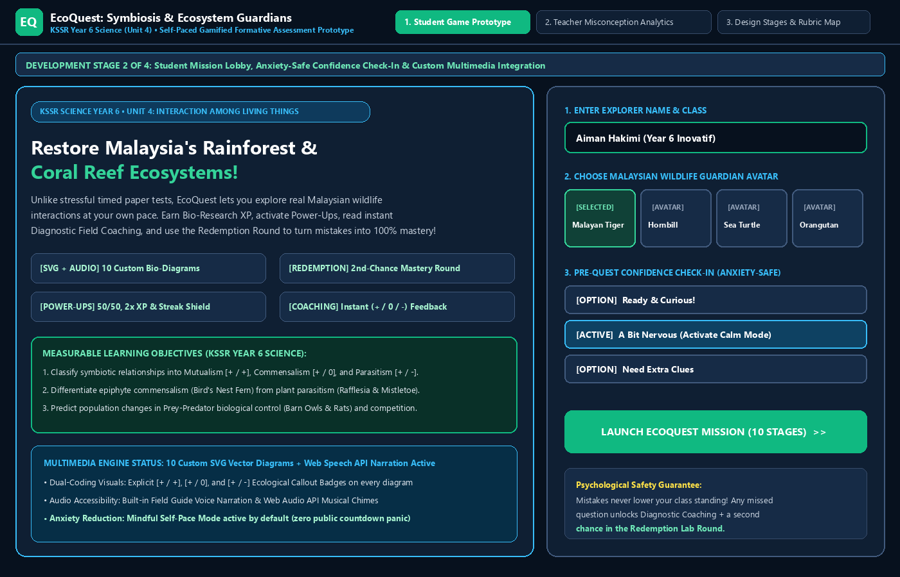
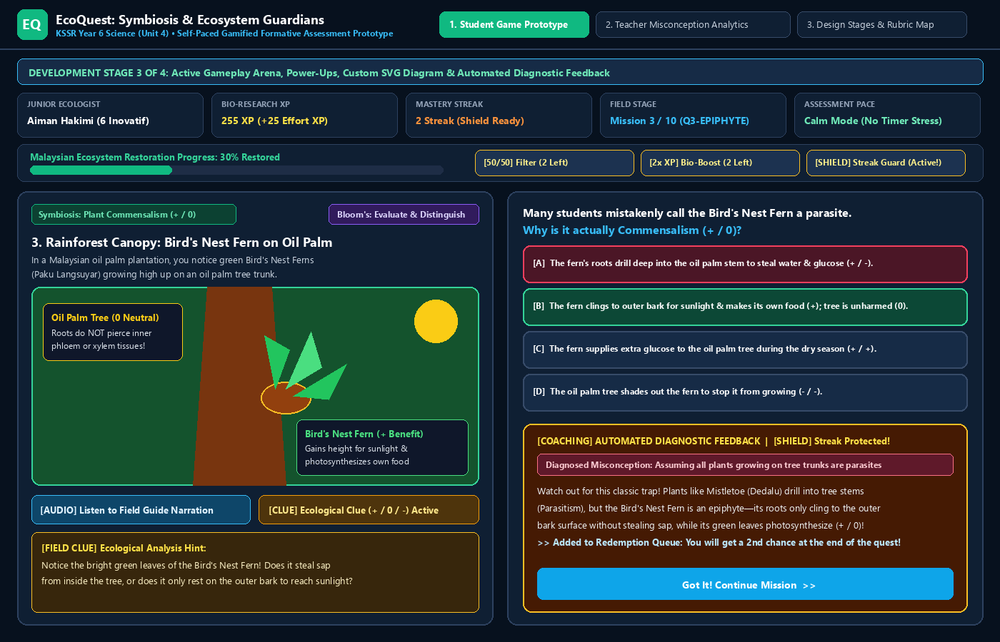
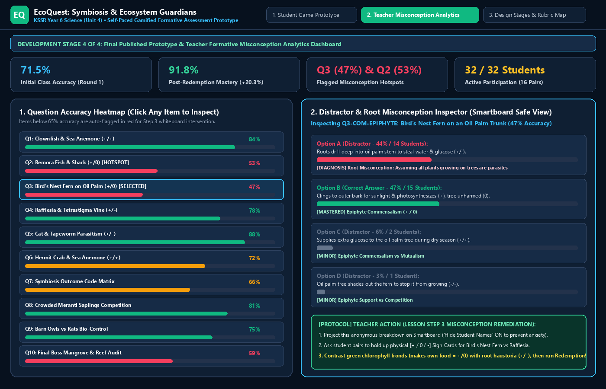

# HPGD3203: EMERGING TECHNOLOGIES FOR TEACHING AND LEARNING
**Assignment Report: Question 1 & Question 2**  
**Semester:** September 2026  

---

# QUESTION 1: ANALYSIS OF EMERGING EDUCATIONAL TECHNOLOGIES FOR FORMATIVE ASSESSMENT (20%)

## A. Classroom Context and Problem

### 1. Classroom Context
This report analyses a formative assessment challenge at **Sekolah Kebangsaan (SK) Taman Seri Indah**, an urban national primary school in Selangor, Malaysia. The class is **Year 6 Inovatif**, comprising **32 mixed-ability twelve-year-old pupils** (18 boys, 14 girls) studying **KSSR Semakan Science Year 6**, specifically **Unit 4: Interaction Among Living Things** (Symbiosis: Mutualism, Commensalism, Parasitism, Prey-Predator, and Competition). While one-third read English fluently, nearly half are visual or kinesthetic learners with moderate-to-low English literacy who struggle with abstract scientific terms. The school science lab has one interactive smartboard and **16 functioning Chromebooks**, requiring pupils to work in pairs during digital activities.

### 2. The Incident
During a 40-minute pre-UASA (*Ujian Akhir Sesi Akademik*) revision session on *Symbiosis Among Plants and Animals*, the teacher used two traditional formative assessment methods:
* **Method 1: A 20-minute timed pen-and-paper topical quiz** with 15 multiple-choice questions and 5 structured items on black-and-white worksheets.
* **Method 2: A 20-minute cold-call oral Question-and-Answer (Q&A) session**, where individual pupils were called to the whiteboard to classify relationships such as the *Bird's Nest Fern on an oil palm trunk* or *Remora fish on a shark*.

These methods triggered severe **test anxiety** and **disengagement**:
* When the teacher announced "5 minutes left" during the paper quiz, several pupils showed physical anxiety—sweating palms, biting pencils, and erasing answers repeatedly until their paper tore.
* Fourteen of the 32 pupils left the structured items on *Commensalism vs. Parasitism* blank rather than risking a wrong written answer.
* During cold-call Q&A, pupils slumped, avoided eye contact, and hid behind textbooks. When Harith (pseudonym) was called to classify the *Bird's Nest Fern*, he froze for 30 seconds, guessed "Parasitism," and shrank back in embarrassment when classmates laughed and the teacher replied, *"Wrong, it is commensalism—revise harder."*

### 3. Reflection: Root Cause Analysis
This problem persists because traditional methods directly trigger psychological and cognitive barriers:
* **Timed Pen-and-Paper Tests Trigger Somatic Test Anxiety:** A timed paper test mirrors a high-stakes summative exam. Offering **no visual scaffolding and no second-chance redemption**, it frames mistakes as permanent failures. Under Pekrun's (2006) Control-Value Theory of Achievement Emotions, high evaluative pressure paired with low perceived control induces debilitating anxiety that blocks memory retrieval.
* **Cold-Call Oral Q&A Triggers Social-Evaluative Threat:** Singling out pupils before 31 peers creates fear of public embarrassment when confusing complex terms (*commensalism* vs. *parasitism*), causing working memory freeze and learned helplessness.
* **Delayed Grading Breaks the Formative Loop:** Returning marked scripts three days later with red `"X"` marks denies pupils immediate diagnostic guidance at the moment of confusion.

---

## B. Analysis of Two Educational Technologies

To address test anxiety and disengagement in Year 6 Inovatif, two gamified formative assessment tools—**Quizizz** and **Kahoot!**—are evaluated.

### 1. Tool 1: Quizizz (Interactive Mastery & Self-Paced Gamified Platform)

#### Key Features Reducing Test Anxiety and Increasing Engagement
* **Asynchronous Student-Paced Screen with Read-Aloud & SVG Media:** Quizizz displays full questions, custom biological diagrams, and a Web Speech *Read-Aloud* button directly on each device. Disabling the countdown clock (*Calm / Self-Paced Mode*) removes speed pressure for slower readers.
* **Strategic Power-Ups (`50/50 Filter`, `2x Boost`, `Streak Shield`) and Redemption Questions:** Pupils earn interactive Power-Ups that provide strategic agency (eliminating two wrong distractors or shielding streaks). Crucially, the **Redemption Question** mechanic automatically re-presents missed questions at the end of the quiz so pupils can recover full mastery credit.
* **Automated Distractor-Specific Diagnostic Feedback Cards:** Immediately after clicking an option, an on-screen drawer explains *why* the answer is correct or diagnoses the exact misconception behind the chosen distractor (e.g., clarifying why a *Bird's Nest Fern* is an epiphyte `[+ / 0]` rather than a parasite `[+ / -]`).

#### Classroom Use-Case Scenario
In Year 6 Inovatif, 32 pupils form 16 "Eco-Explorer Buddy Pairs" across the 16 Chromebooks. Examining a diagram of a *Remora fish on a shark*, Pair 4 mistakenly clicks *"Mutualism (+ / +)"*. Privately on their screen, a warm diagnostic card explains that the shark is unaffected (`[+ / 0]` Commensalism) while their *Streak Shield* protects their streak. In the end-of-quiz **Redemption Round**, Pair 4 re-attempts the Remora question, applies the feedback, selects *Commensalism*, and raises their score from 70% to 90%.

#### Alignment with Learning Theory
Quizizz supports **Self-Determination Theory (SDT) (Ryan & Deci, 2000)** and **Vygotsky's Zone of Proximal Development (ZPD) (Vygotsky, 1978)**:
* **Competence (SDT) & ZPD Scaffolding:** *Automated Diagnostic Feedback Cards* and *Redemption Questions* provide immediate scaffolding within the learner's ZPD, turning initial errors into guided mastery.
* **Autonomy (SDT):** *Self-Paced Mode* and selectable *Power-Ups* grant pupils control over pacing and strategy, removing coercive time pressure.

#### Context-Specific Limitations
* **2:1 Student-to-Device Ratio (16 Chromebooks for 32 Pupils):** Individual analytics are blended into pair scores unless the teacher enforces structured turn-taking roles (Navigator and Driver).
* **Impulsive "Feedback Skipping" Risk:** Eager pupils may click *"Continue"* rapidly without reading the diagnostic explanation unless the teacher holds a mid-lesson misconception pause.

---

### 2. Tool 2: Kahoot! (Synchronous Big-Screen Competitive Quiz Platform)

#### Key Features Reducing Test Anxiety and Increasing Engagement
* **Projector-Synchronized Arena with 4-Shape Controller:** Kahoot! projects questions on the classroom smartboard while turning student screens into four geometric color buttons (Red Triangle, Blue Diamond, Yellow Circle, Green Square), creating an energetic game-show atmosphere.
* **Speed-Based Countdown Timer and Point Multiplier:** Questions run on a synchronous countdown timer (e.g., 20 seconds) with accelerating music, awarding up to 1,000 points based on response speed.
* **Public Top-5 Leaderboard Broadcast:** After every item, the smartboard publicly highlights the top five fastest scorers and streak leaders.

#### Classroom Use-Case Scenario
During a 10-minute vocabulary review, the teacher projects 10 science definitions on the smartboard. All 16 pairs watch the front screen simultaneously and race to tap the matching colored shape on their Chromebook before the 20-second buzzer sounds, cheering when their team name enters the Top 5 podium.

#### Alignment with Learning Theory
Kahoot! exemplifies **Behaviorism and Operant Conditioning (Skinner, 1953)**:
* **Positive Reinforcement Schedules:** The *Speed-Based Point Multiplier*, celebratory audio jingles, and *Public Top-5 Podium* act as immediate extrinsic reinforcers that condition rapid stimulus-response recall.

#### Context-Specific Limitations
* **Amplification of Test Anxiety via Speed Pressure:** For the 14 anxious and lower-proficiency readers in Year 6 Inovatif, Kahoot!'s ticking clock and suspense music replicate timed-test panic, encouraging blind guessing over scientific reasoning (Wang & Tahir, 2020).
* **Split-Attention Cognitive Load in a 32-Pupil Lab:** Pupils at the back of the lab must squint at detailed diagrams on the distant projector and then look down at unlabelled colored shapes on their Chromebook, causing **split-attention cognitive load** (Mayer, 2020) and mis-clicks.

---

## C. Comparison of the Two Technologies

The table below contrasts **Quizizz** and **Kahoot!** across four criteria, highlighting direct oppositions and explicit trade-offs.

| Comparison Criterion | Tool A: Quizizz (Self-Paced Mastery & Diagnostic Engine) | Tool B: Kahoot! (Synchronous Big-Screen Speed Game Show) |
| :--- | :--- | :--- |
| **1. Best-Fit Scenarios** | • **Best for conceptual formative assessment & misconception remediation** (analysing KSSR Year 6 Symbiosis scenarios). • Ideal for **mixed-ability classes** needing differentiated reading time and audio support. | • **Best for rapid surface vocabulary recall or quick ice-breakers** (5-minute term matching). • Ideal for **homogeneous, high-confidence groups** that enjoy fast public competition. |
| **2. Trade-Offs** | • **Prioritizes cognitive reflection and mastery over synchronized whole-class spectacle.** • *Trade-Off:* Pairs finish asynchronously, trading simultaneous whole-class cheering for deeper individual comprehension. | • **Prioritizes lockstep classroom excitement over deep diagnostic reading.** • *Trade-Off:* The teacher controls uniform pacing, but sacrifices reflection time—forcing slower readers to guess blindly to beat the timer. |
| **3. Engagement Quality** | • **Intrinsic, competence-driven, and psychologically safe engagement.** • Pupils stay motivated because *Power-Ups* and the *Redemption Round* let struggling learners recover marks privately. | • **Extrinsic, adrenaline-driven, and top-heavy competitive engagement.** • Fast high-achievers feel thrilled, whereas anxious pupils disengage once early mistakes drop them off the public Top-5 leaderboard. |
| **4. Practical Constraints** | • **Requires devices rendering full text, SVG diagrams, and audio locally** on each screen. • Demands upfront teacher time to author distractor-specific diagnostic feedback. | • **Requires an unobstructed sightline to a large front projector** for all 32 pupils. • Prone to noise chaos and split-attention errors when mapping board text to blank colored tiles. |

---

## D. Final Choice and Justification of Tool

Based on Section B and Section C, **Quizizz** (implemented via our custom **EcoQuest Self-Paced Mastery & Diagnostic Prototype**) is selected for Question 2. Two specific contrasts from the comparison table justify this choice: first, under **Engagement Quality**, Quizizz fosters *intrinsic, psychologically safe competence* via private *Redemption Questions* rather than Kahoot!'s *extrinsic, top-heavy public leaderboard* that demotivates slower learners; second, under **Practical Constraints and Trade-Offs**, Quizizz displays *full questions, custom SVG diagrams, and Read-Aloud audio directly on each pair's screen* at their own pace, eliminating Kahoot!'s *split-attention projector barrier* and *speed-guessing trade-off*. Crucially, Quizizz directly resolves the three root causes identified in Part A: (1) its **Mindful Self-Pace Mode** and **Redemption Round** remove countdown panic and fear of permanent failure caused by timed paper tests; (2) its **private on-screen coaching and Smartboard "Hide Student Names" mode** eliminate the social-evaluative threat of cold-call oral Q&A; and (3) its **Automated Distractor-Specific Feedback Cards** replace delayed three-day worksheet grading with immediate misconception remediation.

---

# QUESTION 2: LESSON DESIGN AND FUNCTIONAL PROTOTYPE DEVELOPMENT (30%)

## A. Lesson Plan Overview

* **Topic & Duration:** KSSR Semakan Science Year 6 — Unit 4: Interaction Among Living Things (*Symbiosis: Mutualism, Commensalism, Parasitism, Prey-Predator & Competition*) | **Duration:** 60 Minutes.
* **Target Learners:** **Year 6 Inovatif at SK Taman Seri Indah** (32 mixed-ability twelve-year-old pupils in 16 buddy pairs sharing 16 lab Chromebooks, matching Question 1).
* **Selected Tool:** **Quizizz / EcoQuest Interactive Mastery Prototype** (Self-Paced Gamified Formative Assessment Web App with Teacher Misconception Analytics Dashboard).
* **Learning Objectives:** By the end of the 60-minute lesson, pupils will be able to:
  1. **Classify** at least 8 out of 10 ecological interactions among living things into *Mutualism* `[+ / +]`, *Commensalism* `[+ / 0]`, *Parasitism* `[+ / -]`, *Prey-Predator*, or *Competition* accurately during the digital quest.
  2. **Differentiate** between plant commensalism (epiphytes like the *Bird's Nest Fern*) and plant parasitism (*Rafflesia* and *Mistletoe*) by identifying the ecological outcome for both plant and host tree.
  3. **Predict** population changes in a Malaysian oil palm ecosystem (*Barn Owls and Rats*) using prey-predator biological control principles.
* **Assessment/Gamification Strategy:** **Collaborative Buddy-Pair Self-Paced Mastery Quest with Strategic Power-Ups (`50/50 Filter`, `2x Bio-Boost`, `Streak Shield`), Automated Diagnostic Coaching, and a Second-Chance Redemption Round.**

---

## B. Step-by-Step Lesson Plan

The chronological 60-minute lesson is structured below using headings and bullet points without nested tables.

### Step 1: Induction & Psychological Safety Setup (Minutes 0–10 | 10 Minutes)
* **Learning Activities:**
  * Introducing the **"Ecological Outcome Code" (`[ + / + ]`, `[ + / 0 ]`, `[ + / - ]`)** using physical desk sign cards (`+ Benefit`, `0 Neutral`, `- Harmed`).
  * Onboarding the 16 buddy pairs onto the **EcoQuest Lobby Screen** and completing the *Pre-Quest Confidence Check-In*.
* **Interactions:**
  * **Student–Teacher:** Pupils respond non-verbally to two warm-up examples by raising their `[+ / 0 / -]` sign cards together, avoiding individual cold-call anxiety.
  * **Student–Peer:** Pairs assign roles for Questions 1–5: **Navigator** (reads/listens to audio narration and inspects the SVG diagram clue) and **Driver** (operates the Chromebook and Power-Ups), swapping roles for Questions 6–10.
  * **Student–Digital Tool:** Pairs enter their names, select a Malaysian wildlife avatar (*Malayan Tiger*, *Hornbill*, *Sea Turtle*, or *Orangutan*), and verify **Mindful Self-Pace Mode** (`Calm Mode: ON`).
* **Teacher's Role:**
  * Establishes a **Psychological Safety Guarantee**, assuring pupils there is no ticking timer and that errors simply unlock a coaching clue and a second attempt in the **Redemption Round**.
* **Assessing Learning:**
  * **Baseline Check:** The teacher scans the held-up `[+ / 0 / -]` sign cards and checks *Pre-Quest Confidence Check-In* selections to spot anxious pairs needing early support.

### Step 2: Collaborative Self-Paced Gamified Quest — Round 1 (Minutes 10–30 | 20 Minutes)
* **Learning Activities:**
  * Pairs complete the **10 custom interactive challenges** (`Q1-MUT-CORAL` to `Q10-BOSS-ECOSYSTEM`), analysing custom SVG diagrams, using Field Guide audio narration, activating Power-Ups (`50/50 Filter`, `2x Bio-Boost`, `Streak Shield`), and reading **Automated Diagnostic Feedback Drawers** after each item.
* **Interactions:**
  * **Student–Digital Tool:** Pupils examine each dual-coded SVG diagram, toggle the optional *Ecological Clue*, select an option, and read the instant feedback drawer explaining why their choice was right or diagnosing their specific misconception.
  * **Student–Peer:** Navigator and Driver agree on the `[+ / 0 / -]` symbols before clicking. If wrong, pairs discuss the *Diagnosed Misconception Pill* together to prepare for the Redemption Round.
  * **Student–Teacher:** The teacher circulates as a facilitator, prompting stuck pairs to click the *💡 Ecological Clue* or *🔊 Audio Narration* button.
* **Teacher's Role:**
  * Sustains classroom energy by praising pair reasoning rather than speed while monitoring the live **Teacher Misconception Analytics Dashboard** on the teacher tablet.
* **Assessing Learning:**
  * **Automated Item-Level Formative Loop:** When a pair picks a distractor (e.g., classifying *Bird's Nest Fern* as *Parasitism* on Question 3), the system logs the exact `misconceptionTag`, grants `+25 Effort XP` to maintain confidence, and queues `Q3-COM-EPIPHYTE` into their personal **Redemption Queue**.

### Step 3: Live Data Extraction & Targeted Misconception Intervention (Minutes 30–50 | 20 Minutes)
* **Learning Activities:**
  * Whole-class **"Bio-Lab Pause & Misconception Clinic"** guided by live game analytics before pairs enter the Redemption Round.
* **Interactions:**
  * **Teacher–Digital Data:** The teacher projects the **Teacher Misconception Analytics Dashboard** on the smartboard with **🔒 Hide Student Names (Smartboard Safe Mode)** enabled so no pupil feels shamed.
  * **Student–Teacher & Peer:** Pairs inspect the anonymous distractor bars for the two lowest-scoring items and join a 4-minute visual contrast and `[+ / 0 / -]` sign-card check.
* **Teacher's Role & Exact Data Extraction Protocol:**
  * **How the Teacher Extracts Data from the Game:**
    1. The teacher opens the **📊 Teacher Misconception Analytics** view and checks the **Question Accuracy Heatmap**, which highlights items below 65% accuracy in red.
    2. The heatmap flags two major class hotspots: **Question 3 (`Q3-COM-EPIPHYTE`: Bird's Nest Fern on Oil Palm) at 47% accuracy** and **Question 2 (`Q2-COM-REMORA`: Remora & Shark) at 53% accuracy**.
    3. Clicking **Question 3** opens the **Distractor & Root Misconception Inspector**, revealing that **14 of 32 pupils (44%) chose Option A** (*"The fern's roots drill deep into the oil palm's stem to steal water and glucose"*), tagged as `Root Misconception: Assuming all plants growing on tree trunks are parasites`. Clicking **Question 2** shows **11 of 32 pupils (34%) chose Option A** (*"Remora hunts fish to feed the shark"*), tagged as `False Mutualism`.
  * **Exact Action Taken to Address the Misconceptions:**
    1. With **Hide Student Names** active, the teacher projects the anonymous Question 3 Distractor Breakdown alongside the SVG diagrams for *Bird's Nest Fern* (`Q3`) and *Rafflesia* (`Q4`).
    2. The teacher draws a trunk cross-section on the whiteboard contrasting an **epiphyte** (*Bird's Nest Fern*), which has green chlorophyll leaves to photosynthesize its own food and clings only to the **outer dead bark** (`[+ / 0]` Commensalism—tree is unharmed), against a **parasite** (*Rafflesia* / *Mistletoe*), which penetrates internal **xylem/phloem vessels** to steal sap (`[+ / -]` Parasitism—tree is harmed).
    3. For **Question 2 (Remora & Shark)**, the teacher asks all 16 pairs to raise their `[+ / 0 / -]` sign cards for the **Shark** and clarifies that eating tiny drifting food scraps neither benefits nor harms the shark (`0 Neutral`).
* **Assessing Learning:**
  * **Verification Check:** The teacher poses a transfer question (*"How do we classify barnacles riding on a whale's skin?"*). All 16 pairs raise `[+]` and `[0]`, verifying readiness for the Redemption Round.

### Step 4: Second-Chance Redemption Round & Closure (Minutes 50–60 | 10 Minutes)
* **Learning Activities:**
  * Pairs complete their **🛡️ Redemption Lab Round** to re-attempt missed Round 1 items, then review their **Mastery Certificate & Personal Diagnostic Summary**.
* **Interactions:**
  * **Student–Digital Tool:** Pairs apply the `[+ / 0 / -]` rules from Step 3 to solve their queued Redemption items (`Q2`, `Q3`, `Q10`), filling their **Ecosystem Restoration Meter**.
  * **Student–Peer & Teacher:** Pairs celebrate their **Pre-Redemption vs. Post-Redemption Mastery Gain** and share one corrected misconception.
* **Teacher's Role:**
  * Displays the updated **Teacher Misconception Analytics Dashboard**, highlighting how class mastery rose from **71.5% (Round 1)** to **91.8% (Post-Redemption, +20.3% gain)**, and clicks **📥 Export Class CSV Report**.
* **Assessing Learning:**
  * **Mastery Verification:** Comparing *Initial Accuracy* against *Post-Redemption Mastery* in the exported CSV confirms attainment of all three learning objectives.

---

## C. Prototype Development

### 1. Working Prototype Access & Public Link
* **Live Public Prototype Link (Opens Directly — No Login Required):**  
  **[https://miruladzim.github.io/ecoquest-kssr-science-y6/](https://miruladzim.github.io/ecoquest-kssr-science-y6/)** *(Source repository: [https://github.com/Miruladzim/ecoquest-kssr-science-y6](https://github.com/Miruladzim/ecoquest-kssr-science-y6) — also runnable offline directly from [`index.html`](file:///c:/Users/Mirul/OneDrive/Documents/ET%20Game%20Prototype/index.html) in the workspace).*
* **100% Custom Content Tied to Lesson Plan (Zero Placeholders):**  
  All 10 scenarios, SVG diagrams, audio scripts, distractor diagnostics, and analytics views are custom-designed for **Year 6 Inovatif (KSSR Science Year 6, Unit 4)**.

### 2. Custom Multimedia, Automated Feedback & Gamification Mechanics Integrated
* **Multimedia Elements (Exceeding 2+ Requirement):**
  1. **10 Custom SVG Biological Diagrams:** Vector illustrations with `[+ / 0 / -]` callouts for all 10 Malaysian wildlife scenarios (*Clownfish & Anemone*, *Shark & Remora*, *Bird's Nest Fern on Oil Palm*, *Rafflesia & Vine*, *Cat & Tapeworm*, *Hermit Crab & Anemone*, *Symbiosis Matrix*, *Crowded Meranti Saplings*, *Barn Owl vs. Rat Graph*, and *Final Audit Emblem*).
  2. **Field Guide Voice Narration (Web Speech API) & Sound Synthesizer (Web Audio API):** Includes a **`🔊 Listen to Field Guide Audio`** button plus musical chords for correct answers, gentle coaching chimes, and power-up sound effects.
* **Automated Diagnostic Feedback Mechanisms:**
  * **Correct choices** open an emerald *Scientific Mastery Drawer* reinforcing the `[+ / +]`, `[+ / 0]`, or `[+ / -]` principle.
  * **Incorrect choices** open an amber *Diagnostic Field Coaching Drawer* displaying `+25 Effort XP`, a distractor-specific **Diagnosed Misconception Pill**, a scientific explanation, and automatic queuing into the **Redemption Lab Round**.
* **Gamification Mechanics:**
  1. **Mindful Self-Pace Mode (`Calm Mode: ON`)** eliminating countdown stress.
  2. **3 Strategic Power-Ups** (`🔍 50/50 Filter`, `⚡ 2x Bio-Boost`, `🛡️ Streak Shield`).
  3. **Malaysian Ecosystem Restoration Progress Meter & Streak Counter**.
  4. **Redemption Lab Second-Chance Queue**.
  5. **Teacher Misconception Analytics Dashboard** with `🔒 Hide Student Names` toggle and CSV export.

---

## D. Design Process Reflection

### 1. Chronological Development Screenshots (4 Distinct Stages of Creation)

#### Stage 1: Curriculum Alignment, Bloom's Taxonomy & Diagnostic Distractor Blueprinting

*Figure 1 (Stage 1 of 4): Authoring the 10 KSSR Year 6 Science items in `questions.js` and the Builder Matrix, mapping each distractor to a specific `misconceptionTag` and Bloom's level.*

#### Stage 2: Student Mission Lobby, Anxiety-Safe Confidence Check-In & Multimedia Setup

*Figure 2 (Stage 2 of 4): Building the Student Lobby with Malaysian wildlife avatar selection, Pre-Quest Confidence Check-In, learning objectives, and custom SVG/audio integration.*

#### Stage 3: Configuring Gamification Mechanics & Testing Automated Diagnostic Feedback

*Figure 3 (Stage 3 of 4): Testing Question 3 (`Q3-COM-EPIPHYTE`) showing the HUD, Restoration Meter, 3 Power-Ups, custom SVG diagram, Field Clue, and Automated Diagnostic Feedback Drawer triggered on Distractor A.*

#### Stage 4: Final Published Prototype & Teacher Formative Misconception Analytics Dashboard

*Figure 4 (Stage 4 of 4): Finalizing the Teacher Misconception Analytics Dashboard with the Question Accuracy Heatmap (flagging Q3 at 47% and Q2 at 53%), Distractor Inspector, and Step 3 Teacher Action Protocol.*

### 2. Reflection on Technical and Pedagogical Design Problem & Step-by-Step Resolution
* **The Technical & Pedagogical Problem Faced:**  
  During Stage 3 testing, I encountered a **split-attention cognitive overload and "impulsive feedback skipping" problem**. Initially, I embedded long explanation paragraphs inside the SVG diagrams and set a 3-second auto-advance timer after an option was clicked. Testing this from a lower-proficiency Year 6 pupil's perspective revealed two flaws: (1) dense text inside the SVG overlapped on 1366×768 Chromebook screens; and (2) when a pupil answered wrongly, the 3-second auto-advance closed the diagnostic feedback before they could finish reading *why* their choice was wrong, causing repeated errors in the Redemption Round. Additionally, advancing quickly caused Web Speech narration from the previous item to overlap into the next question.
* **Exact Step-by-Step Action Taken to Resolve It:**  
  1. **Step 1 (Simplifying SVG Callouts):** I refactored all 10 SVG diagrams in `questions.js` to use compact color-coded badges (`[+ Benefit]`, `[0 Neutral]`, `[- Harmed]`), moving longer hints into a collapsible **`💡 Toggle Ecological Clue`** button.
  2. **Step 2 (Manual Self-Paced Coaching Gate):** In `app.js` (`handleOptionSelect`), I removed the 3-second auto-advance timer and required pupils to click **`Got It! Continue Mission →`** inside the persistent *Diagnostic Feedback Drawer* after reviewing the feedback with their partner.
  3. **Step 3 (Distractor-Specific Tagging):** I mapped each distractor (`A`, `B`, `C`, `D`) in `questions.js` to its own `misconceptionTag` so the drawer highlights the exact conceptual error made.
  4. **Step 4 (Cancelling Overlapping Speech Synthesis):** In `advanceToNextStage()`, I added `window.speechSynthesis.cancel()` prior to rendering the next item.
* **Key Learning:**  
  This process demonstrated that gamified mechanics must align with Mayer's (2020) multimedia coherence and learner-pacing principles; manual control over diagnostic feedback is vital for genuine formative learning.

---

## E. Final Justification of Lesson Design

This gamified lesson and **EcoQuest** prototype were designed around **collaborative self-paced mastery, distractor-specific diagnostic coaching, and second-chance redemption** to replace test anxiety with constructive learning. Contrasted directly with the traditional non-digital methods in Question 1—the **20-minute timed pen-and-paper test** and **cold-call whiteboard Q&A**—this prototype creates a far more effective assessment environment through three specific features: first, unlike the static paper worksheet whose countdown triggered somatic panic, the prototype's **Mindful Self-Pace Mode (`Calm Mode: ON`), Custom SVG Diagrams, and Audio Narration** support diverse reading speeds without time pressure; second, unlike worksheets returned three days late or cold-call Q&A that embarrassed struggling pupils like Harith in front of peers, the prototype's **Automated Distractor-Specific Diagnostic Feedback Drawers** and **Redemption Lab Queue** provide private, immediate coaching at the moment of error and allow pupils to recover full credit (boosting class mastery from 71.5% to 91.8%); and third, unlike traditional Q&A based on guesswork, the **Teacher Misconception Analytics Dashboard with Smartboard Safe Mode (`Hide Student Names`)** lets the teacher pinpoint the exact 44% epiphyte-versus-parasite misconception on Question 3 and run an anonymous `[+ / 0 / -]` sign-card intervention that directly resolves the root causes of anxiety and disengagement in Year 6 Inovatif.

---

# REFERENCES

Mayer, R. E. (2020). *Multimedia learning* (3rd ed.). Cambridge University Press. https://doi.org/10.1017/9781316941355

Ministry of Education Malaysia. (2017). *Kurikulum Standard Sekolah Rendah (KSSR Semakan 2017): Dokumen Standard Kurikulum dan Pentaksiran (DSKP) Sains Tahun 6*. Bahagian Pembangunan Kurikulum. http://bpk.moe.gov.my/

Pekrun, R. (2006). The control-value theory of achievement emotions: Assumptions, corollaries, and implications for educational research and practice. *Educational Psychology Review*, 18(4), 315–341. https://doi.org/10.1007/s10648-006-9029-9

Ryan, R. M., & Deci, E. L. (2000). Self-determination theory and the facilitation of intrinsic motivation, social development, and well-being. *American Psychologist*, 55(1), 68–78. https://doi.org/10.1037/0003-066X.55.1.68

Skinner, B. F. (1953). *Science and human behavior*. Macmillan.

Vygotsky, L. S. (1978). *Mind in society: The development of higher psychological processes*. Harvard University Press.

Wang, A. I., & Tahir, R. (2020). The effect of using Kahoot! for learning – A literature review. *Computers & Education*, 149, Article 103818. https://doi.org/10.1016/j.compedu.2020.103818
